# Poly Haven: Lighting models

**32 assets from [Poly Haven](https://polyhaven.com), dedicated to the public domain under [CC0](https://polyhaven.com/license).** Use them in any game, free or paid, and change them however you like; no credit is needed.

3D models as glTF at 1K and 2K texture resolution, each folder self-contained (`.gltf`, `.bin`, `textures/`). 332.0 MB in all.

This is a copy kept by [zuujis-cc0](https://github.com/zuujis-cc0) so game makers can take single files from GitHub. It is not made by or affiliated with Poly Haven: the originals, often in more formats and higher resolutions, are on [polyhaven.com](https://polyhaven.com). If they help you, consider [supporting Poly Haven](https://www.patreon.com/polyhaven/overview).

Every file is listed in [MANIFEST.tsv](MANIFEST.tsv) with its size and SHA-256. More free assets: [the Zuujis collection](https://github.com/zuujis-cc0/free-game-assets#readme).

| | | | |
| :-: | :-: | :-: | :-: |
| <a href="Chandelier_01">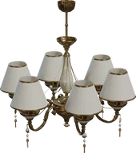</a> <b><a href="Chandelier_01">Chandelier 01</a></b> by Kirill Sannikov · <a href="https://polyhaven.com/a/Chandelier_01">source</a> | <a href="Chandelier_02">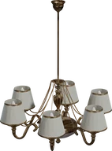</a> <b><a href="Chandelier_02">Chandelier 02</a></b> by Kirill Sannikov · <a href="https://polyhaven.com/a/Chandelier_02">source</a> |  <b><a href="Chandelier_03">Chandelier 03</a></b> by Kirill Sannikov · <a href="https://polyhaven.com/a/Chandelier_03">source</a> |  <b><a href="Lantern_01">Lantern 01</a></b> by Rajil Jose Macatangay · <a href="https://polyhaven.com/a/Lantern_01">source</a> |
|  <b><a href="brass_candleholders">Brass Candleholders</a></b> by Tina · <a href="https://polyhaven.com/a/brass_candleholders">source</a> | <a href="brass_diya_lantern">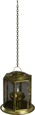</a> <b><a href="brass_diya_lantern">Brass Diya Lantern</a></b> by Bhargav Kubal · <a href="https://polyhaven.com/a/brass_diya_lantern">source</a> |  <b><a href="caged_hanging_light">Caged Hanging Light</a></b> by Ulan Cabanilla · <a href="https://polyhaven.com/a/caged_hanging_light">source</a> | <a href="chinese_chandelier">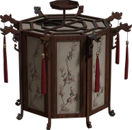</a> <b><a href="chinese_chandelier">Chinese Chandelier</a></b> by Kirill Sannikov · <a href="https://polyhaven.com/a/chinese_chandelier">source</a> |
|  <b><a href="desk_lamp_arm_01">Desk Lamp Arm 01</a></b> by Kuutti Siitonen, Yann Kervran · <a href="https://polyhaven.com/a/desk_lamp_arm_01">source</a> | <a href="flood_lights">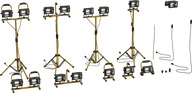</a> <b><a href="flood_lights">Flood Lights</a></b> by James Ray Cock · <a href="https://polyhaven.com/a/flood_lights">source</a> |  <b><a href="hanging_industrial_lamp">Hanging Industrial Lamp</a></b> by Kuutti Siitonen · <a href="https://polyhaven.com/a/hanging_industrial_lamp">source</a> | <a href="industrial_caged_sconce">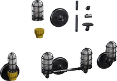</a> <b><a href="industrial_caged_sconce">Industrial Caged Sconce</a></b> by Ulan Cabanilla · <a href="https://polyhaven.com/a/industrial_caged_sconce">source</a> |
|  <b><a href="industrial_pipe_lamp">Industrial Pipe Lamp</a></b> by Mateusz Sadek · <a href="https://polyhaven.com/a/industrial_pipe_lamp">source</a> | <a href="industrial_wall_lamp">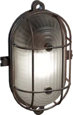</a> <b><a href="industrial_wall_lamp">Industrial Wall Lamp</a></b> by Kuutti Siitonen · <a href="https://polyhaven.com/a/industrial_wall_lamp">source</a> |  <b><a href="industrial_wall_sconce">Industrial Wall Sconce</a></b> by Ulan Cabanilla · <a href="https://polyhaven.com/a/industrial_wall_sconce">source</a> | <a href="lantern_chandelier_01">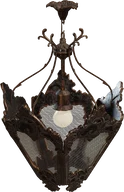</a> <b><a href="lantern_chandelier_01">Lantern Chandelier 01</a></b> by Kirill Sannikov · <a href="https://polyhaven.com/a/lantern_chandelier_01">source</a> |
| <a href="lightbulb_01">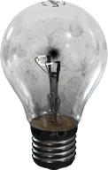</a> <b><a href="lightbulb_01">Lightbulb 01</a></b> by Josh Dean · <a href="https://polyhaven.com/a/lightbulb_01">source</a> | <a href="lightbulb_led">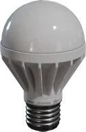</a> <b><a href="lightbulb_led">Lightbulb Led</a></b> by Josh Dean · <a href="https://polyhaven.com/a/lightbulb_led">source</a> | <a href="modern_ceiling_lamp_01">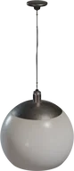</a> <b><a href="modern_ceiling_lamp_01">Modern Ceiling Lamp 01</a></b> by James Ray Cock · <a href="https://polyhaven.com/a/modern_ceiling_lamp_01">source</a> | <a href="mounted_fluorescent_lights">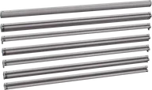</a> <b><a href="mounted_fluorescent_lights">Mounted Fluorescent Lights</a></b> by Ulan Cabanilla · <a href="https://polyhaven.com/a/mounted_fluorescent_lights">source</a> |
|  <b><a href="pastic_torch_6v">Plastic Torch 6V</a></b> by James Cocks · <a href="https://polyhaven.com/a/pastic_torch_6v">source</a> | <a href="portable_searchlight">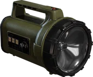</a> <b><a href="portable_searchlight">Portable Searchlight</a></b> by Elijah Cragg · <a href="https://polyhaven.com/a/portable_searchlight">source</a> |  <b><a href="pull_chain_light_socket">Pull Chain Light Socket</a></b> by Josh Dean · <a href="https://polyhaven.com/a/pull_chain_light_socket">source</a> |  <b><a href="security_light">Security Light</a></b> by Maximilian Schuster · <a href="https://polyhaven.com/a/security_light">source</a> |
| <a href="signal_flashlight">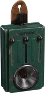</a> <b><a href="signal_flashlight">Signal Flashlight</a></b> by Jiří Ptáček · <a href="https://polyhaven.com/a/signal_flashlight">source</a> | <a href="small_plastic_torch">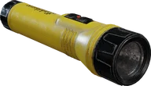</a> <b><a href="small_plastic_torch">Small Plastic Torch</a></b> by Abiyyu Panggalih (Abiyyu_xyz) · <a href="https://polyhaven.com/a/small_plastic_torch">source</a> | <a href="street_lamp_01">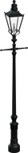</a> <b><a href="street_lamp_01">Street Lamp 01</a></b> by Josh Dean · <a href="https://polyhaven.com/a/street_lamp_01">source</a> |  <b><a href="street_lamp_02">Street Lamp 02</a></b> by Josh Dean · <a href="https://polyhaven.com/a/street_lamp_02">source</a> |
| <a href="vintage_flashlight">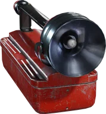</a> <b><a href="vintage_flashlight">Vintage Flashlight</a></b> by Omar M. El-Safy · <a href="https://polyhaven.com/a/vintage_flashlight">source</a> | <a href="vintage_oil_lamp">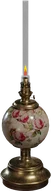</a> <b><a href="vintage_oil_lamp">Vintage Oil Lamp</a></b> by Monsta3D · <a href="https://polyhaven.com/a/vintage_oil_lamp">source</a> |  <b><a href="wooden_candlestick">Wooden Candlestick</a></b> by Josh Dean · <a href="https://polyhaven.com/a/wooden_candlestick">source</a> | <a href="wooden_lantern_01">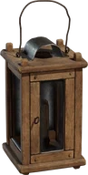</a> <b><a href="wooden_lantern_01">Wooden Lantern 01</a></b> by James Ray Cock · <a href="https://polyhaven.com/a/wooden_lantern_01">source</a> |

---

Kept up to date by this repository's own [update workflow](.github/workflows/update.yml), with code and plan from [cc0-mirror](https://github.com/zuujis-cc0/cc0-mirror). Something wrong? [Open an issue there](https://github.com/zuujis-cc0/cc0-mirror/issues/new) or use the [private report form](https://games.zuujis.com/report).
